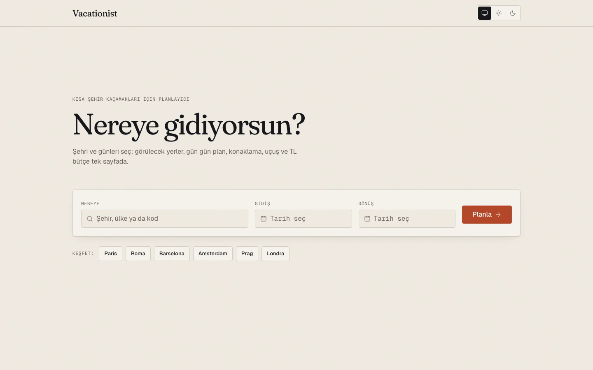
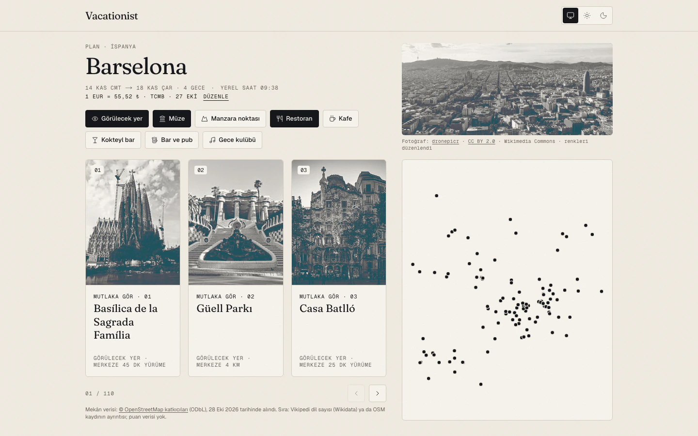
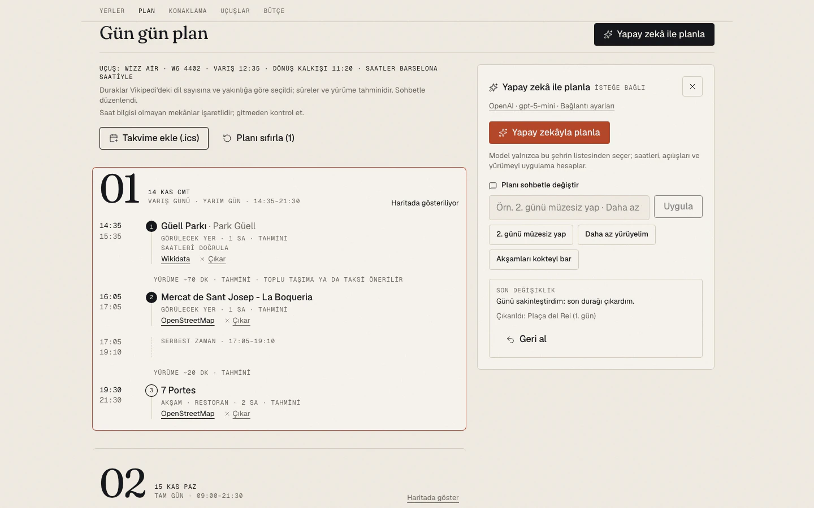
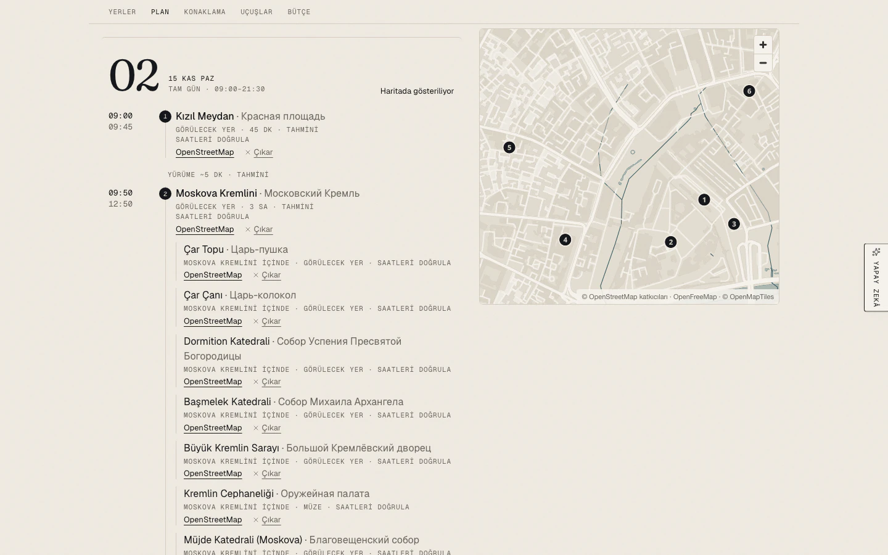
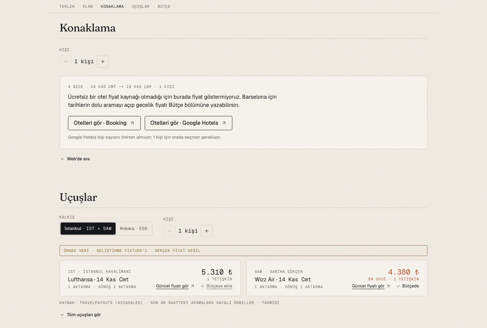
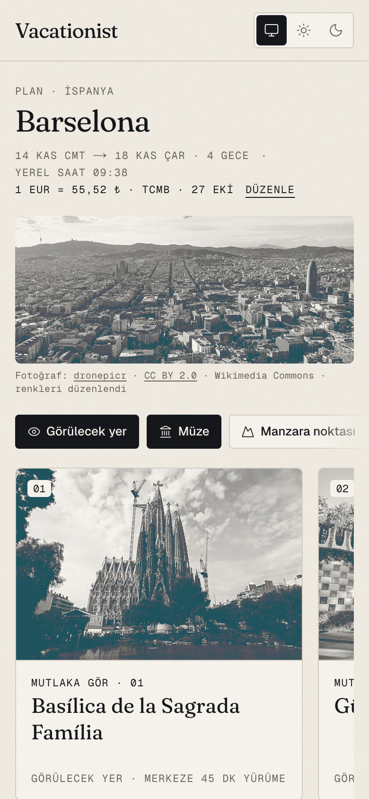
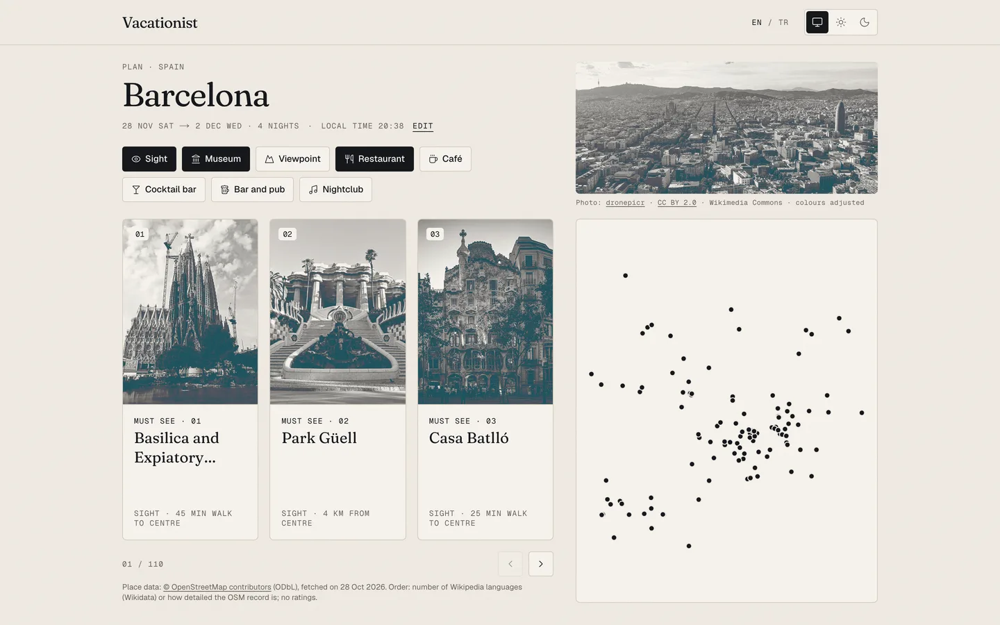
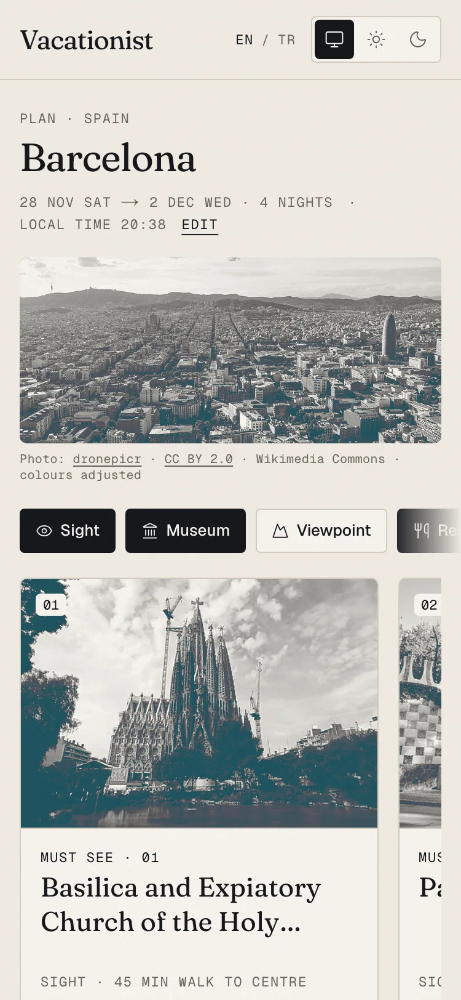

# Vacationist

Kısa şehir tatili için ücretsiz, açık kaynak planlayıcı: şehri ve günleri seç, istediğin şehirden kalk; 68 şehirde görülecek yerler, gün gün plan, en ucuz uçuş ve bütçe (TL, EUR, USD ya da GBP) tek sayfada gelsin, yapay zekâ isteğe bağlı ve kendi anahtarınla.

**Canlı:** <https://vacationist-app.vercel.app>

*Kısa şehir kaçamakları için planlayıcı.* Açık kaynak ve tamamen ücretsiz servislerle çalışır. Repo ve paket adı `vacation-assistant` olarak kalır.

| Ana sayfa | Plan |
| --- | --- |
|  |  |
| **Gün gün plan ve yapay zekâ paneli** | **Alt duraklar: Moskova Kremlini** |
|  |  |
| **Konaklama ve uçuşlar** | **Telefonda plan** |
|  |  |
| **İngilizce arayüz (`/en/plan`)** | **İngilizce, telefonda** |
|  |  |

<sub>Ekran görüntüleri 2026-10-29'da yerel üretim build'inden, açık temada alındı (masaüstü 1440 px, telefon 390 px; İngilizce olanlar 375 px). Uçuşlar örnek veriyle (`VA_FLIGHTS_FIXTURES=1`; fiyatlar gerçek değildir), yapay zekâ paneli yerel bir sahte sağlayıcıyla; gerçek anahtar kullanılmadı.</sub>

## Ne yapar

- **Nereye ve ne zaman:** ana sayfa yalnızca varış şehrini ve tarihleri sorar ("Nereye gidiyorsun?"); Avrupa'dan Körfez'e, Kuzey Afrika'dan Uzak Doğu'ya 68 şehir. Kalkış (uçuşa açık havalimanı olan her şehir, varsayılan İstanbul: IST + SAW) ve kişi sayısı plan sayfasında, Konaklama ve Uçuşlar bölümlerinde seçilir; son kalkış tarayıcıda hatırlanır.
- **Görülecek yerler:** OpenStreetMap ve Wikidata'dan önceden çekilmiş mekânlar; Vikipedi'de kaç dilde olduğuna göre "mutlaka gör" sırası, Commons fotoğraflı karusel, harita ve kategoriler (görülecek yer, müze, manzara, restoran, kafe, kokteyl bar, bar ve pub, gece kulübü). Kokteyl barları Wikidata'dan takviye edilir.
- **Okunur adlar:** Latin harfli bir ad varsa o gösterilir ("Tokyo Kulesi · 東京タワー"); yoksa ad ülkenin resmî sistemiyle Latin harflerine çevrilir (Rusça, Sırpça, Bulgarca, Makedonca, Özbekçe, Yunanca, Gürcüce, Korece), yerel ad küçük yazıyla kalır.
- **Merkeze uzaklık:** şehrin turistik merkezinden uzak yerler "MERKEZE ~6 KM" etiketini taşır; 3 km'den uzun yürüyüşte "TOPLU TAŞIMA YA DA TAKSİ ÖNERİLİR".
- **Etkinlikler:** gezinin tarihlerinde şehirde büyük, yıllık bir etkinlik (festival, karnaval, Noel pazarı, film ya da müzik festivali) varsa "Etkinlik" çipiyle, tarihiyle ve kaynağıyla (Wikidata) gösterilir; kesin tarihli olanlar şehir başlığında ve gün gün planda not olarak da görünür. Tarih bilinmiyorsa etkinlik gösterilmez.
- **Gün gün plan:** deterministik; uçuş saatlerine, açılış saatlerine ve yürüme mesafesine göre. Bir yerin içindeki yerler (Moskova Kremlini'ndeki Çar Çanı, Vatikan Müzeleri'ndeki Stanze di Raffaello) alt durak olarak onunla gelir; merkeze uzak bir bölge tek güne toplanır. Durak çıkarılabilir, plan `.ics` olarak takvime eklenir ve yazdırılabilir.
- **Konaklama:** Booking ve Google Hotels'te tarihleri ve kişi sayısı dolu arama linkleri (otel fiyatı uydurulmaz).
- **Uçuşlar:** kalkış şehrinin her havalimanından (Londra'da LHR, LGW, STN, LTN, LCY, SEN) en ucuz bilet, altında tam liste ve aktarmasız filtresi (Travelpayouts önbelleği, "tahmini" etiketiyle).
- **Bütçe:** uçuş, konaklama ve günlük harcama seçtiğin para biriminde (TL, EUR, USD, GBP; çapraz kur TL üzerinden), kaynak ve kurla; değerler ve para birimi URL'de, paylaşılan link aynı planı açar.
- **Türkçe ve İngilizce:** Türkçe kökte (`/`, `/plan`), İngilizce `/en` altında (`/en`, `/en/plan`). Başlıktaki TR / EN anahtarı aynı sayfayı bütün parametreleriyle öbür dilde açar; tarayıcı diline göre otomatik yönlendirme yok. İngilizce sayfada yer, şehir, havalimanı ve etkinlik adları Wikidata'nın İngilizce etiketleriyle, tarih ve sayılar `en-GB` biçiminde, bütçe varsayılan olarak EUR; yapay zekâ cevapları da arayüz dilinde.

### Yapay zekâ olmadan tam çalışır

Plan, sıralama ve bütçe yapay zekâya ihtiyaç duymaz; aynı girdi her zaman aynı planı verir.

### İstersen kendi anahtarınla yapay zekâ (BYOK)

Anthropic, OpenAI ya da Google Gemini anahtarını bağlayıp planı sohbetle değiştirebilirsin ("ikinci günü daha sakin yap", "müzeleri azalt"). Panel gün gün planın yanındaki "Yapay zekâ ile planla" sekmesinden açılır: masaüstünde sağda, günler solda görünür kalır; telefonda alttan tam ekran. Anahtar **yalnızca tarayıcında** kalır (varsayılan sekme oturumu, istersen "Bu cihazda hatırla"); çağrılar tarayıcından doğrudan sağlayıcıya gider, sunucumuza hiç uğramaz, URL'ye yazılmaz, loglanmaz. Model yalnızca çekilmiş mekân listesinden seçer; saat, açılış ve yürüme kurallarını uygulama hesaplar.

**Gemini ücretsiz katman notu:** Gemini'nin ücretsiz katmanı plan sohbeti için yeterli. "Web'de ara" (uçuş fiyatı ve semte göre otel aralığı) ise ücretsiz katmanda yalnızca Gemini 2.5 modellerinde vardı ve Google bu modelleri yeni hesaplara kapattı; Gemini 3'te ücretsiz katmanda Google Search yok (2026-10-21'de kontrol edildi). Anthropic ve OpenAI'da web araması sağlayıcının kendi ücretiyle çalışır.

### Dürüst veri

Her fiyat, kur ve tahmin kaynağıyla ve "tahmini" etiketiyle gösterilir. Bir kaynak cevap vermezse uygulama bunu açıkça söyler; tahmini ya da sabit değer uydurmaz. Konaklama ve günlük harcama için hazır "ortalama" yoktur: yalnızca senin girdiğin değer. Uçuş, otel ya da arama siteleri kazınmaz.

## Veri kaynakları ve lisanslar

| Veri | Kaynak | Lisans / şart |
| --- | --- | --- |
| Türk pasaportu (umuma mahsus) vize durumu (veri kodda; faz 1 arayüzünde gösterilmiyor) | [Passport Index Data](https://github.com/imorte/passport-index-data) (Şubat 2026 sonrası), önceki sürümü [ilyankou/passport-index-dataset](https://github.com/ilyankou/passport-index-dataset); veri [passportindex.org](https://www.passportindex.org) kaynaklı | MIT. `src/data/visa-tr.json` kaynak commit'ini ve tarihini taşır; `npm run data:visa` ile güncellenir. |
| Resmî vize bilgisi (link) | [T.C. Dışişleri Bakanlığı — Türk Vatandaşlarının Tabi Olduğu Vize Uygulamaları](https://www.mfa.gov.tr/turk-vatandaslarinin-tabi-oldugu-vize-uygulamalari.tr.mfa) | Yalnızca link verilir. |
| Döviz kurları | [TCMB günlük kurları](https://www.tcmb.gov.tr/kurlar/today.xml) (döviz satış) | Kaynak olarak "TCMB" gösterilir. |
| Döviz kurları (yedek) | [Frankfurter](https://frankfurter.dev) — Avrupa Merkez Bankası verisi | Ücretsiz, anahtarsız. |
| Döviz kurları (ikinci yedek) | [Rates By Exchange Rate API](https://www.exchangerate-api.com) (open access) | Kur gösterilen sayfada atıf linki zorunlu; uygulama bunu otomatik ekler. Verinin toplu olarak yeniden dağıtılması yasak. |
| Kalkış şehirleri ve havayolları | [OurAirports](https://ourairports.com/data/) `airports.csv` (tarifeli büyük ve orta havalimanları) · Türkçe adlar ve havayolu adları [Wikidata](https://www.wikidata.org)'dan (havalimanı IATA kodu P238, hizmet verdiği yer P931, havayolu kodu P229) · saat dilimleri [GeoNames](https://www.geonames.org) `cities1000` | OurAirports kamu malı; Wikidata CC0; GeoNames [CC BY 4.0](https://creativecommons.org/licenses/by/4.0/) (atıf footer'da). Çok havalimanlı şehirler IATA metropol koduyla gruplanır (`src/lib/origins/metros.ts`). `src/data/origins.json` `npm run data:origins`, `src/data/airlines.json` `npm run data:airlines` ile üretilir, ayda bir tazelenir ve yalnızca sunucuda okunur (tarayıcı `/api/origins?q=` ile birkaç satır alır). Travelpayouts'un statik dosyaları yeniden dağıtım izni olmadığı için kullanılmaz. |
| Uçuş fiyatları | [Travelpayouts](https://www.travelpayouts.com) — [Aviasales Data API](https://support.travelpayouts.com/hc/en-us/articles/203956163) (`v3/prices_for_dates`) | Partner programı; token yalnızca sunucuda (`TRAVELPAYOUTS_TOKEN`). **Fiyatlar önbellekten, tahminidir:** Aviasales kullanıcılarının son 48 saatteki aramalarında bulunmuş, bir yetişkin için gidiş-dönüş fiyatlarıdır; satın alma anındaki fiyat farklı olabilir. Her bilette "ÖNBELLEKTEN · … · TAHMİNİ" yazar ve "Güncel fiyatı gör" Aviasales'te aynı aramayı Travelpayouts partner linkiyle (`tp.media`, marker + proje kimliği) açar. Google Flights'a yalnızca link verilir. |
| Konaklama | [Booking](https://www.booking.com) ve [Google Hotels](https://www.google.com/travel/hotels) | Yalnızca link (API yok): şehir, giriş-çıkış tarihi ve kişi sayısı dolu arama. Google Hotels kişi sayısını linkten almıyor. Uygulama otel fiyatı göstermez; ücretsiz bir otel fiyat kaynağı yok. |
| Bütçe | Uçuş: Travelpayouts önbelleği · konaklama ve günlük harcama: **kullanıcının girdiği değer** · kur: yukarıdaki kur zinciri | Konaklama ve günlük harcama için hazır ya da "ortalama" değer yoktur; girilmeyen satır toplama eklenmez ve toplam "KISMİ TOPLAM" olarak işaretlenir. Değerler URL'de durur (`&flight=…&stay=…&daily=…&cur=…`), paylaşılan link aynı bütçeyi açar. |
| Gün gün plan | Önceden çekilmiş mekân verisi (OpenStreetMap, Wikidata, Vikipedi dil sayısı) ve bütçedeki uçuş | Yapay zekâ bağlı değilse tamamen deterministik: aynı girdi her zaman aynı planı verir. Gündüz 18:00'e kadar zamana göre dolar (en fazla 6 durak; bir yerin içindeki yerler alt durak olarak sayılmaz), akşam mekânı 19:30'da; akşama 90 dakikadan uzun boşluk "SERBEST ZAMAN" olarak görünür, uydurma durakla doldurulmaz. Ziyaret süreleri, yürüme tahmini (kuş uçuşu × 1,3 ÷ 4,5 km/s) ve gün saatleri `src/lib/itinerary/config.ts`'te; hepsi "tahmini" etiketli. Açılış saati bilinmeyen durakta "SAATLERİ DOĞRULA" yazar. Çıkarılan duraklar URL'de (`&skip=…`); plan `.ics` olarak indirilebilir (istemcide üretilir). |
| Yapay zekâ (isteğe bağlı) | Kullanıcının kendi anahtarıyla [Anthropic](https://platform.claude.com/settings/keys), [OpenAI](https://platform.openai.com/api-keys) ya da [Google Gemini](https://aistudio.google.com/app/apikey) (ücretsiz katmanı var) | Anahtar yalnızca tarayıcıda durur (varsayılan sekme oturumu, "Bu cihazda hatırla" ile cihaz); çağrılar tarayıcıdan doğrudan sağlayıcıya gider, sunucumuza hiç uğramaz; kullanım kullanıcının hesabından ücretlendirilir. Model yalnızca çekilmiş mekân listesinden kimlikle seçer; cevap zod ile doğrulanır, liste dışı kimlikte bir kez daha sorulur, yine olmazsa deterministik plan kalır. Saat, açılış ve yürüme kurallarını uygulama hesaplar. Sohbet düzenlemeleri yapılandırılmış komutlardır (`&ai=…&edit=…` URL'de; anahtar asla URL'de değil). **Web'de ara:** modelin kendi web arama aracıyla uçuş fiyatı ve semte göre otel aralığı; Anthropic ve OpenAI'da yalnızca sağlayıcının kaynak listesindeki https sayfalara linklenen sonuçlar gösterilir, bütçenin para birimindeki karşılığı tahminidir, Travelpayouts'tan ayrı durur; Gemini'nin Google Search cevabı, kullanım koşulları gereği, kaynakları ve arama önerileriyle değiştirilmeden gösterilir (fiyat okunmaz, bütçeye kullanıcı yazar). Arama Anthropic ve OpenAI'da ayrıca ücretlendirilir; Gemini'nin ücretsiz katmanında arama yalnızca 2.5 modellerinde var ve Google bunları yeni hesaplara kapattı (ücretli katmanda ayda 5.000 arama ücretsiz). |
| Şehirler ve koordinatlar | [Wikidata](https://www.wikidata.org) | CC0. |
| Mekânlar (görülecek yer, müze, restoran, bar…) | [OpenStreetMap](https://www.openstreetmap.org/copyright), [Overpass API](https://wiki.openstreetmap.org/wiki/Overpass_API) üzerinden | **ODbL 1.0.** `src/data/places/` OSM'den türetilmiş bir veritabanıdır ([lisans notu](src/data/places/README.md)); "© OpenStreetMap katkıcıları" atfı listede ve haritada. Veri `npm run data:places` ile önceden çekilir ve ayda bir tazelenir; uygulama çalışırken Overpass'a istek atmaz. |
| "Vikipedi'de N dilde" sıralaması | [Wikidata](https://www.wikidata.org) sitelinks (`wbgetentities`, 50'şerlik toplu istek) | CC0; tanımlayıcı User-Agent ile. |
| Önemli yerler, türleri, "içinde" bağları, kokteyl barları ve adlar | [Wikidata Query Service](https://query.wikidata.org) (şehir başına birkaç küçük SPARQL sorgusu, yalnızca veri script'inde) | CC0; tanımlayıcı User-Agent ile, istekler sırayla ve geri çekilmeyle. Latin harfli ad yoksa romanizasyon kod içindeki tablolarla yapılır (ICAO Doc 9303, ELOT 743, Korece Revised Romanization…). |
| Etkinlikler | [Wikidata](https://www.wikidata.org) (festival, karnaval, panayır, Noel pazarı, film ve müzik festivali serileri; `npm run data:events`, ayda bir) | CC0. Tarih yalnızca Wikidata'dan: edisyonun gün hassasiyetinde tarihi ya da serinin ayları ("GENELDE"); ikisi de yoksa etkinlik gösterilmez. Her kartta "Tarihleri resmî kaynaktan doğrula". |
| Şehir ve mekân fotoğrafları | [Wikimedia Commons](https://commons.wikimedia.org) (Wikidata P18) | Yalnızca CC0, kamu malı, CC BY ve CC BY-SA. Fotoğrafçı, lisans linki ve "renkleri düzenlendi" notu şehir fotoğrafının altında, mekân fotoğraflarında ayrıntı panelinde. Meta veri önceden çekilir; görsel Commons CDN'inden gelir. |
| Harita karoları | [OpenFreeMap](https://openfreemap.org) (OpenMapTiles şeması), [MapLibre GL JS](https://maplibre.org) ile | Ücretsiz, anahtarsız; "© OpenStreetMap katkıcıları · OpenFreeMap" atfı haritada. |

Her fiyat, kur ve etkinlik tarihi kaynağıyla gösterilir; bir kaynak cevap vermezse uygulama bunu açıkça söyler, tahmini ya da sabit değer uydurmaz. Sayfa sonunda da kaynaklar ve lisansları listelenir.

## Ölçüm

Yayındaki sitede ziyaretler [Vercel Web Analytics](https://vercel.com/docs/analytics) ile çerezsiz ve anonim sayılır.

- **Ölçülen:** hangi sayfanın açıldığı, yalnızca yolu (`/`, `/plan`…), ve Vercel'in standart alanları (ülke, tarayıcı, cihaz türü, başka siteden gelindiyse referrer).
- **Ölçülmeyen:** plan içeriğin. URL'deki şehir, tarih, kalkış, kişi, bütçe, çıkarılan duraklar, yapay zekâ seçimleri ve düzenlemeleri gönderilmeden önce atılır (`src/lib/analytics.ts`); custom event yok; yapay zekâ anahtarın ve sohbetin zaten sunucuya gelmez.
- **Nerede:** yalnızca production deployment'ında; geliştirmede, önizlemede ve yerel build'de betik yüklenmez. Betik ve gönderim kendi alan adımızdan (`/_vercel/insights/*`).
- **Kapatmak:** Vercel'de **Project → Analytics → Disable** ya da `src/app/layout.tsx`'ten `<SiteAnalytics />` satırını kaldır. Ayrıntı: [docs/DEPLOY.md](docs/DEPLOY.md#7-ölçüm-vercel-web-analytics).

## Yerelde çalıştırma

Node 22 gerekir (`.nvmrc`).

```bash
npm ci
npm run dev
```

Uygulama <http://localhost:3000>'de açılır. Uçuşlar için `.env.example`'ı `.env.local` olarak kopyalayıp şu değişkenleri doldur (değerler yalnızca `.env.local`'de durur, asla commit'lenmez):

- `TRAVELPAYOUTS_TOKEN`
- `TRAVELPAYOUTS_MARKER`
- `TRAVELPAYOUTS_PROJECT_ID`

Token olmadan da her şey çalışır; uçuş bölümü bilet kartları yerine Aviasales ve Google Flights linklerini gösterir.

**Demo modları** (yalnızca yerelde, Vercel'de çalışmaz):

- `VA_AI_MOCK=1 npm run dev` — yapay zekâ ve web aramasını anahtarsız örnek cevaplarla açar; her sonuçta "ÖRNEK VERİ" yazar.
- `VA_FLIGHTS_FIXTURES=1 npm run dev` — token olmadan örnek uçuş verisi; sayfada "ÖRNEK VERİ · GERÇEK FİYAT DEĞİL" bandı görünür.

Sık kullanılan komutlar (tam liste ve ayrıntılar [AGENTS.md](AGENTS.md)'de):

| Komut | Ne yapar |
| --- | --- |
| `npm run lint` | ESLint (uyarı da hata sayılır) |
| `npm run typecheck` | Route tipleri + `tsc --noEmit` |
| `npm test` | Vitest birim testleri |
| `npm run build` | Üretim derlemesi |
| `npm run check:bundle` | Sunucuya özel veri ve token istemci paketine sızmamış mı |
| `npm run test:e2e` | Playwright uçtan uca testleri, axe erişilebilirlik ve klavye turu dahil (önce `npm run build`) |
| `npm run data:places` | Mekân verisini yeniden çeker (ağ ister, ~3 saat) |
| `npm run data:events` | Etkinlikleri Wikidata'dan yeniden çeker (ağ ister, şehir başına ~30 sn) |
| `npm run data:origins` | Kalkış şehirlerini OurAirports, Wikidata ve GeoNames'ten yeniden çeker (ağ ister, ~1 dk) |
| `npm run data:airlines` | Havayolu adlarını Wikidata'dan yeniden çeker (ağ ister, birkaç saniye) |

Vercel'e kurulum, ortam değişkenleri, Travelpayouts hesabı ve aylık veri yenileme: [docs/DEPLOY.md](docs/DEPLOY.md).

### Geliştirici notları

- Node 22 (`.nvmrc`). Komutlar için [AGENTS.md](AGENTS.md).
- Mekân verisi `src/data/places/` altında commit'lenir; elle tazelemek için `npm run data:places` (tüm şehirler, sırayla; yaklaşık üç saat; yarıda kalırsa aynı komut son 24 saatte çekilenleri atlayıp kaldığı yerden sürer, `-- --force` hepsini yeniden çeker) ya da `npm run data:places -- BCN SJJ`. Görülecek yer kuralları okurken uygulanır (`src/lib/places/rules.ts`, istisnalar `src/data/place-overrides.ts`); kural değiştirmek yeniden çekme gerektirmez. Tür etiketlerini ve `relink` istisnalarını yalnızca Wikidata'dan tazelemek için `npm run data:kinds` (birkaç dakika); bağlantı denetimi `npm run verify:place-links`.
- **Aylık tazeleme** (`.github/workflows/refresh-places.yml`) değişiklik varsa yeni bir branch'e commit atıp "chore: refresh place data" PR'ı açar. Bunun çalışması için repo ayarlarında **Settings → Actions → General → Workflow permissions** altında **"Allow GitHub Actions to create and approve pull requests"** seçeneği açık olmalı.
- **Uçuşlar:** `.env.example`'ı `.env.local` olarak kopyalayıp `TRAVELPAYOUTS_TOKEN`, `TRAVELPAYOUTS_MARKER` ve `TRAVELPAYOUTS_PROJECT_ID`'yi doldur (Vercel'de ortam değişkeni olarak). Partner link biçimini `npm run verify:partner-links` Travelpayouts'un partner link API'siyle karşılaştırır (ağ ister). Token yoksa uçuş bölümü kart yerine Aviasales ve Google Flights linklerini gösterir. Token olmadan arayüzü görmek için `VA_FLIGHTS_FIXTURES=1` örnek veriyi açar; sayfa bunu "ÖRNEK VERİ · GERÇEK FİYAT DEĞİL" bandıyla belirtir ve bu mod Vercel'de çalışmaz.
- `GITHUB_TOKEN` ile açılan PR'lar başka workflow'ları tetiklemez; tazeleme PR'ında CI'ı merge'den önce elle çalıştır (testler tazeleme workflow'unun içinde zaten koşar).

## Katkı

Hata bildirimi ve PR'lar memnuniyetle karşılanır.

- Önce [AGENTS.md](AGENTS.md) (çalışma kuralları), [docs/DESIGN.md](docs/DESIGN.md) (görsel dil) ve [docs/PRD.md](docs/PRD.md) (ürün gereksinimleri).
- Her iş kendi branch'inde: `feat/…`, `fix/…`, `docs/…`, `chore/…`; commit mesajları İngilizce, Conventional Commits.
- PR'dan önce `npm run lint`, `npm run typecheck`, `npm test`, `npm run build`, `npm run check:bundle` ve `npm run test:e2e` geçmeli.
- Kurallar: yalnızca ücretsiz servisler, kazıma yok, uydurma veri yok; arayüz metinleri Türkçe ve İngilizce, yalnızca `src/i18n/messages/` altındaki mesaj dosyalarından (iki dosyanın anahtarları aynı); ham renk değeri yalnızca `src/app/globals.css`'te.
- Gizli anahtarlar asla commit'lenmez.

Belgeler: [PRD](docs/PRD.md) · [DESIGN](docs/DESIGN.md) · [PLAN](docs/PLAN.md) · [DEPLOY](docs/DEPLOY.md) · [BACKLOG](docs/BACKLOG.md) · [AGENTS](AGENTS.md)

## Lisans

Kod: [MIT](LICENSE). `src/data/places/` altındaki OSM türevi veri: [ODbL 1.0](src/data/places/README.md). `src/data/origins.json`: OurAirports (kamu malı), Wikidata (CC0) ve saat dilimleri için GeoNames ([CC BY 4.0](https://creativecommons.org/licenses/by/4.0/)); `src/data/airlines.json`: Wikidata (CC0). Open Graph kartlarındaki fontlar (`assets/og/`): SIL Open Font License 1.1. Her Commons fotoğrafı kendi lisansıyla, yazarı ve lisansı yanında gösterilir.

---

## English summary

**Vacationist** is a free, open source planner for short city breaks. Pick one of 68 cities and your dates; it lays out the sights, a day-by-day plan, stay links, the cheapest flight from any city with an airport (Istanbul by default) and a budget (TRY, EUR, USD or GBP) on one page. Live: <https://vacationist-app.vercel.app>

- Works fully without AI: the plan is deterministic, built from pre-fetched OpenStreetMap and Wikidata data. Places inside another place (the Tsar Bell in the Moscow Kremlin) come with it as sub-stops; far-off places carry a "~6 km from the centre" caption.
- Readable names: a Latin-script name is preferred; otherwise the name is romanized with the country's official system, with the local name kept small.
- Big yearly events (festivals, carnivals, Christmas markets) in your dates, from Wikidata only; no guessed dates.
- Optional bring-your-own-key AI (Anthropic, OpenAI, Gemini) in a side panel to edit the plan by chat; the key stays in your browser and calls go straight to the provider. Gemini's free tier covers chat, but free web search is no longer available to new Gemini accounts.
- Honest data: every price and estimate shows its source and an "estimated" label; nothing is made up and nothing is scraped. Privacy-friendly analytics count page paths only.
- Runs on free services only (Vercel Hobby, Travelpayouts, TCMB/Frankfurter/open.er-api, OpenFreeMap).
- Run locally with Node 22: `npm ci && npm run dev`; `VA_AI_MOCK=1` and `VA_FLIGHTS_FIXTURES=1` give keyless demos. Deploy guide: [docs/DEPLOY.md](docs/DEPLOY.md).
- Code under MIT; place data under ODbL 1.0. The interface is in Turkish (at the root) and English (under [/en](https://vacationist-app.vercel.app/en)), with a TR / EN switch that keeps the trip's parameters; English pages use Wikidata's English names, British English formats and a EUR budget by default.
