<p align="right"><b>English</b> · <a href="README.tr.md">Türkçe</a></p>

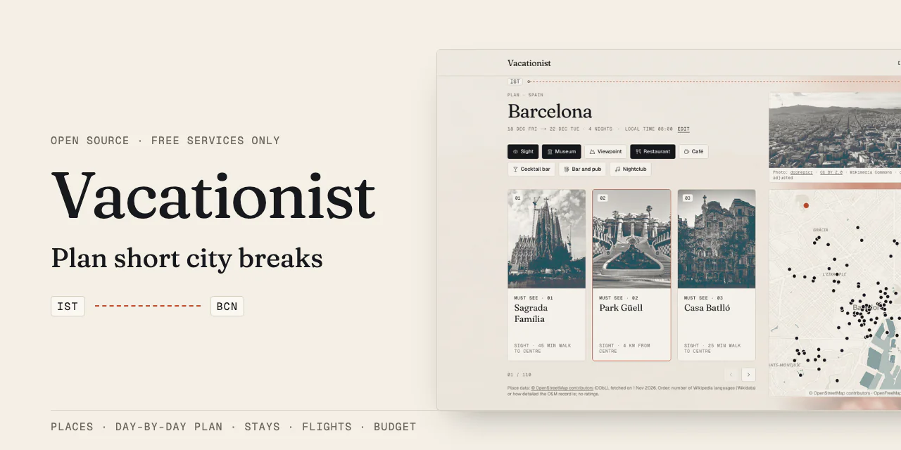

# Vacationist

[](https://github.com/Tngc93/vacation-assistant/actions/workflows/ci.yml)
[](LICENSE)
[](https://vacationist-app.vercel.app/en)
[](#features)

**Live:** <https://vacationist-app.vercel.app/en> (English) · <https://vacationist-app.vercel.app> (Turkish)

## What it does

Vacationist is a free, open source planner for short city breaks. You pick one of 68 cities and your dates; one page then lays out the sights on a map, a day-by-day plan that respects flight times, opening hours and walking distances, links to search stays, the cheapest flight from any city with an airport, and a budget in TRY, EUR, USD or GBP. It works fully without AI, runs only on free services and open data, and never makes up a price: every number shows where it came from.

The repository and package are named `vacation-assistant`; the product is Vacationist.

## Demo


## How it works

### 1. Choose a city and dates

The home page asks only where and when: a city (or country, or airport code) and the two dates. The "Discover" chips pick a city and open the calendar. Behind the form, a dotted map draws the route from your departure city.

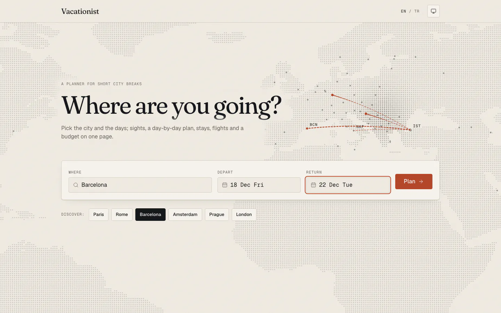

### 2. Places and map

The plan opens with the city: dates, local time, category chips (sights, museums, viewpoints, restaurants, cafés, cocktail bars, bars and pubs, nightclubs), a carousel of places with Commons photos, the city photo and a map. Cards and map dots are linked: point at a card and its dot lights up; click a dot and the carousel scrolls to its card.


### 3. Day-by-day plan

A deterministic plan engine fills each day with the best-known places (ranked by the number of Wikipedia languages), ordered by distance, timed around your flights, with opening-hour checks, walking estimates, evening venues and free time it doesn't pad. Remove a stop and the day re-plans; export the trip as an `.ics` calendar or print it. Shown here in the dark theme.


### 4. Stays

Booking and Google Hotels searches with the city, dates and guests already filled in. Hotel prices are not shown, because there is no free, honest source for them; you add the nightly rate you choose to your budget.

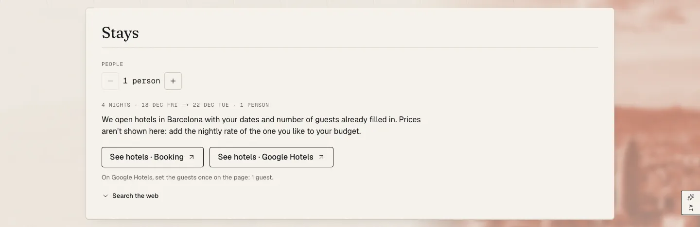

### 5. Flights

The cheapest cached fare from each airport of your departure city (Istanbul: IST and SAW; London: six airports), with the full list, a direct-only filter and a "See the current price" link. In this screenshot the flights are the labelled sample data used in development.

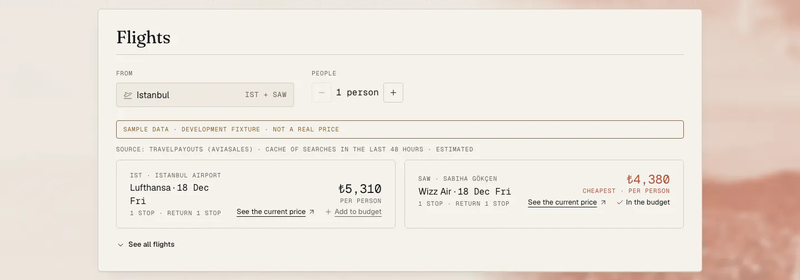

### 6. Budget

The flight, the stay and the daily spending in the currency you pick (TRY, EUR, USD, GBP; cross rates go through the Turkish lira), with the source and date of the rate. Values you type stay in the URL, so a shared link opens the same budget.

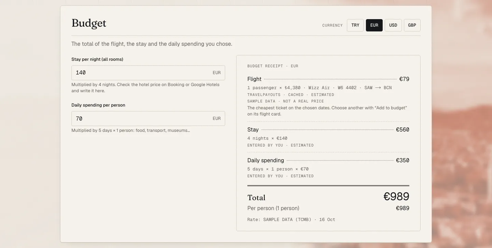

## Features

- **Plan-first flow.** The home page asks only where and when; the departure city and the number of people are chosen on the plan, in the stays and flights sections. The last departure city is remembered in the browser.
- **Route-map home background.** A dotted map of Europe, the Middle East and North Africa (from Natural Earth) where routes draw from your departure city; the chosen city's route stays on screen. It loads after the page is idle, pauses off screen, and stands still with reduced motion or a data saver.
- **City atmosphere.** The plan page sits on a blurred copy of the city photo, toned with the theme's colours and drifting slowly behind the section cards; it makes no extra request, nothing is tied to scrolling, and it stands still with reduced motion.
- **Places inside places.** Places that are part of another place (from Wikidata) come with it as sub-stops: the Tsar Cannon and the Tsar Bell follow the Moscow Kremlin on the same day.

  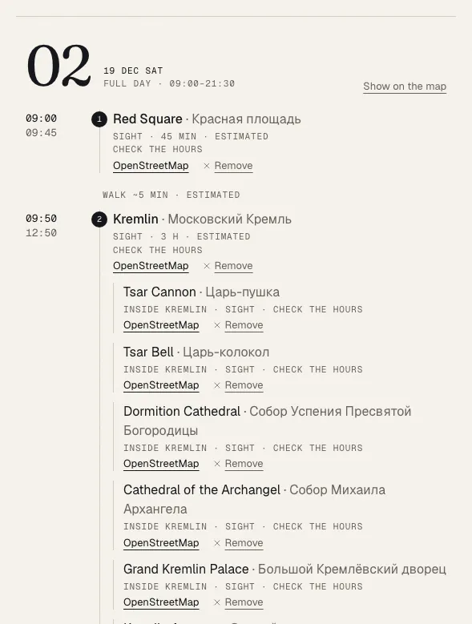
- **"~X KM FROM CENTRE".** Places far from the tourist centre are captioned with the distance, walks over 3 km suggest public transport or a taxi, and a far-off area is kept to one day.

  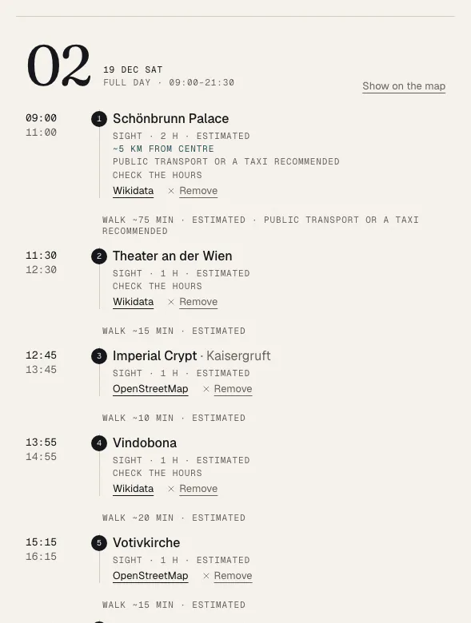
- **Events.** Big yearly festivals, carnivals, Christmas markets and film or music festivals in your dates, from Wikidata only. Each shows its date and source, and an event without a known date isn't shown.

  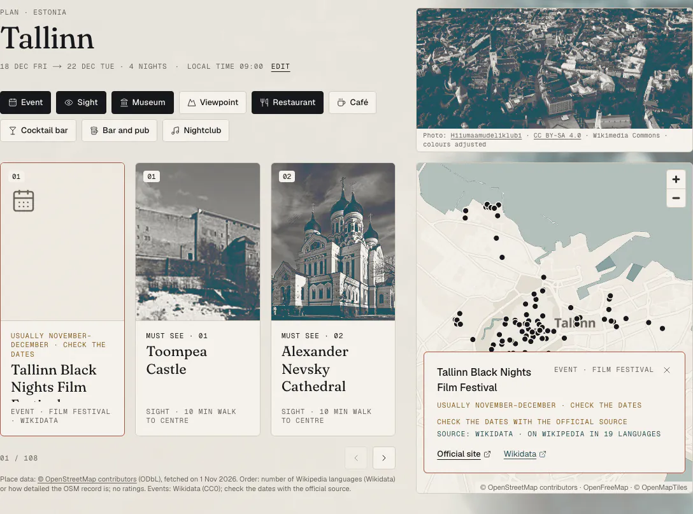
- **Cocktail bars.** OpenStreetMap's cocktail bars are topped up with the bars Wikidata lists, which come first and are marked.

  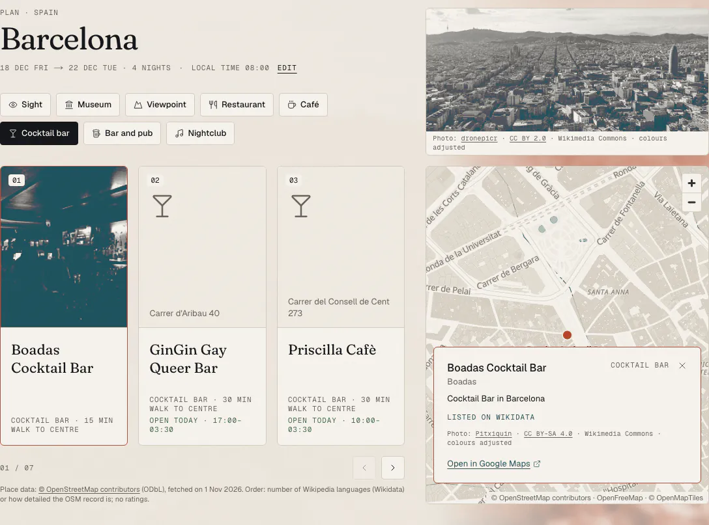
- **Depart from anywhere.** About 3,200 departure cities with scheduled flights (OurAirports, Wikidata, GeoNames), grouped by metropolitan code, so London searches LCY, LGW, LHR, LTN, SEN and STN at once.

  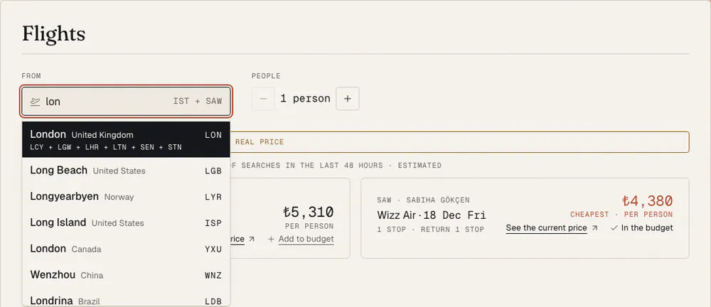
- **Budget currency.** TRY, EUR, USD or GBP, with rates from TCMB, then Frankfurter, then Exchange Rate API; money is kept in whole minor units and converted once, so totals add up. If a rate can't be fetched, the budget says so and stays in lira.
- **TR / EN.** Turkish at the root, English under `/en`. The switch in the header opens the same page in the other language with all its parameters. English pages use English Wikipedia's names, British English dates and a EUR budget by default.

  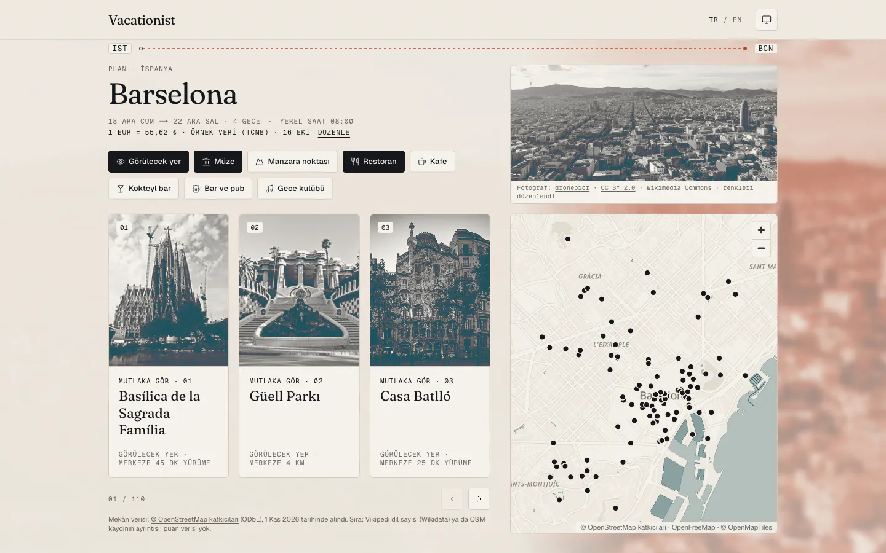
- **PWA and offline.** Install it with the browser's own "Add to Home Screen" or "Install app". The last ten plans you opened open without a connection, under an offline strip, with flight prices marked as not current. API calls, analytics and AI calls are never cached.
- **Bring your own key AI.** Connect an Anthropic, OpenAI or Google Gemini key in the side panel and change the plan by chatting ("No museums on day 2"). The key stays in your browser and calls go straight from the browser to the provider. The model only chooses from the city's list; the app still works out times, opening hours and walking. Each edit can be undone and lives in the URL. With a key, "Search the web" can also look up flight prices and stay ranges using the model's own web search.

  

## Mobile

<p>
  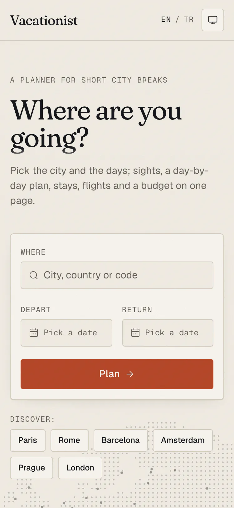
  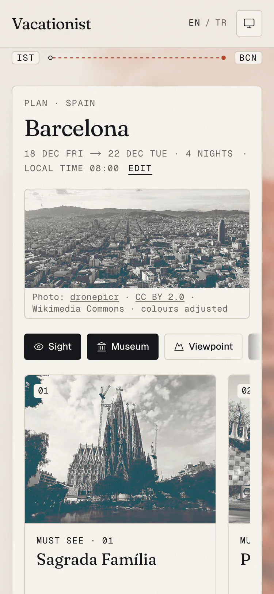
  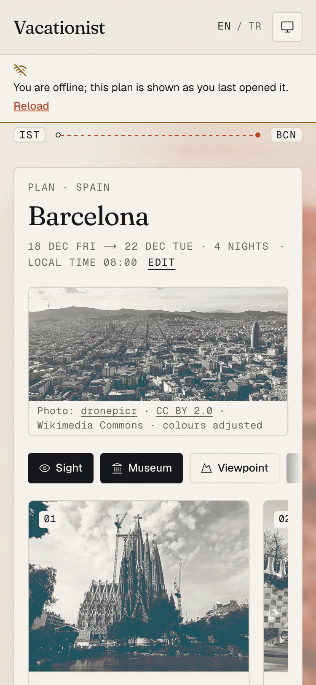
</p>

Home, plan and the installed app offline, at a 375 × 812 viewport (2× pixel ratio). The third screenshot emulates the installed app: `display-mode: standalone` set over the DevTools protocol, the plan saved by the service worker on a first visit, then reloaded with the network off.

## Architecture

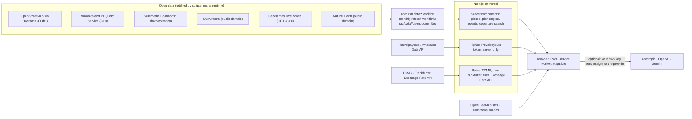

- **Data at build time.** Places, events, departure cities, airline names and the home map's dot grid are fetched ahead of time by scripts, committed as JSON and read only on the server; the app makes no Overpass, Wikidata or Commons API calls while it runs. A GitHub Actions workflow refreshes places and events monthly and opens a PR.
- **Server-side live data.** Flight prices (Travelpayouts, token in an environment variable, never sent to the browser) and exchange rates (TCMB, then Frankfurter, then Exchange Rate API; no rate is ever made up). `npm run check:bundle` fails the build if place data or the token reach the client bundle.
- **Browser-side.** Map tiles from OpenFreeMap and photos from the Commons CDN. The optional AI calls go from the browser straight to the provider; they never pass through our server or the service worker. The Content-Security-Policy lets the page connect only to its own origin, the map tiles and those three APIs.

## Data sources and licences

| Data | Source | Licence / terms |
| --- | --- | --- |
| Places (sights, museums, restaurants, bars…) | [OpenStreetMap](https://www.openstreetmap.org/copyright) via the [Overpass API](https://wiki.openstreetmap.org/wiki/Overpass_API) | [ODbL 1.0](src/data/places/README.md); attributed in the list and on the map |
| Cities, coordinates, rankings (Wikipedia languages), landmarks, "inside" links, cocktail bars, English and Turkish names, events, airline names | [Wikidata](https://www.wikidata.org) and the [Wikidata Query Service](https://query.wikidata.org) | CC0 |
| City, place and event photos | [Wikimedia Commons](https://commons.wikimedia.org) (Wikidata P18) | Each file's own licence; only CC0, public domain, CC BY and CC BY-SA files are used, with author, licence link and "colours adjusted" shown |
| Departure airports | [OurAirports](https://ourairports.com/data/) `airports.csv` | Public domain |
| Departure time zones | [GeoNames](https://www.geonames.org) `cities1000` | [CC BY 4.0](https://creativecommons.org/licenses/by/4.0/), attributed in the footer |
| Home page map | [Natural Earth](https://www.naturalearthdata.com) 1:110m land polygons | Public domain |
| Map tiles | [OpenFreeMap](https://openfreemap.org) (OpenMapTiles schema) with [MapLibre GL JS](https://maplibre.org) | Free, no key; "© OpenStreetMap contributors · OpenFreeMap" on the map |
| Flight prices | [Travelpayouts](https://www.travelpayouts.com) — Aviasales Data API (`v3/prices_for_dates`) | Partner programme; cached prices from searches in the last 48 hours, labelled estimated |
| Exchange rates | [TCMB](https://www.tcmb.gov.tr/kurlar/today.xml), fallbacks [Frankfurter](https://frankfurter.dev) (ECB data) and [Exchange Rate API](https://www.exchangerate-api.com) (open access) | Source shown with each rate; Exchange Rate API requires an attribution link, added automatically |
| Stays | [Booking](https://www.booking.com) and [Google Hotels](https://www.google.com/travel/hotels) | Links only, no API and no prices |
| Visa data (in the code, not shown in the current interface) | [passport-index-data](https://github.com/imorte/passport-index-data) | MIT |
| Open Graph card fonts (`assets/og/`) | Fraunces and Geist Mono | SIL Open Font License 1.1 |

The footer of every page lists the same sources. Nothing is scraped: no flight, hotel or search site is crawled.

## Honest data

Every price, rate and estimate shows its source and an "estimated" label. If a source doesn't answer, the page says so instead of guessing; there are no default or "average" values for stays or daily spending, only what you enter. Event dates come only from Wikidata, and an event without one isn't shown. Opening hours that can't be read are marked "check the hours". Sample data in development is labelled on the page.

## Privacy

The privacy page is at [vacationist-app.vercel.app/en/privacy](https://vacationist-app.vercel.app/en/privacy). In short: visits are counted with Vercel Web Analytics without cookies, only the page path is sent (the trip in the URL is stripped first) and there are no custom events. Your AI key and chat stay in your browser.

## Tech stack

- [Next.js](https://nextjs.org) 16 (App Router, Turbopack, React Server Components and streaming) with React 19 and TypeScript (strict)
- [Tailwind CSS](https://tailwindcss.com) 4 with design tokens in `src/app/globals.css`; Fraunces, Geist and Geist Mono via `next/font`
- [MapLibre GL JS](https://maplibre.org) with [OpenFreeMap](https://openfreemap.org) tiles; Canvas 2D for the home map and the plan atmosphere
- [Zod](https://zod.dev) for URL parameters and every external response, [react-day-picker](https://daypicker.dev), [lucide-react](https://lucide.dev) icons, [fast-xml-parser](https://github.com/NaturalIntelligence/fast-xml-parser) for TCMB's XML
- A hand-written service worker (`public/sw.js`), no PWA package
- [Vitest](https://vitest.dev) and Testing Library; [Playwright](https://playwright.dev) with [axe-core](https://github.com/dequelabs/axe-core) for end-to-end and accessibility tests
- [Vercel](https://vercel.com) (Hobby) hosting and Web Analytics; GitHub Actions for CI and the monthly data refresh

## Getting started

Node 22 is required (`.nvmrc`).

```bash
npm ci
npm run dev
```

The app opens at <http://localhost:3000>. Everything works without any key. For live flight prices, copy `.env.example` to `.env.local` and fill in these variables (values stay in `.env.local` and are never committed):

- `TRAVELPAYOUTS_TOKEN`
- `TRAVELPAYOUTS_MARKER`
- `TRAVELPAYOUTS_PROJECT_ID`

Without them the flights section shows links to Aviasales and Google Flights instead of tickets.

Demo modes (local only; they don't run on Vercel):

- `VA_AI_MOCK=1 npm run dev` — the AI web search with keyless sample answers, each marked "SAMPLE DATA".
- `VA_FLIGHTS_FIXTURES=1 npm run dev` — sample flights, under a "SAMPLE DATA · NOT A REAL PRICE" band.
- `VA_RATES_FIXTURES=1` — a saved TCMB bulletin instead of live exchange rates (EUR, USD, JPY, KRW; no GBP).

Deploying to Vercel, environment variables, the Travelpayouts account and the monthly data refresh: [docs/DEPLOY.md](docs/DEPLOY.md).

## Scripts

| Command | What it does |
| --- | --- |
| `npm run dev` | Development server (Turbopack) at <http://localhost:3000> |
| `npm run build` | Production build |
| `npm start` | Runs the production build |
| `npm run lint` | ESLint; warnings count as errors |
| `npm run typecheck` | Next.js route types, then `tsc --noEmit` |
| `npm test` | Vitest unit and component tests (`npm run test:watch` to watch) |
| `npm run test:e2e` | Playwright end-to-end tests against the production build, including axe and a keyboard tour (`npm run build` first) |
| `npm run check:bundle` | After a build: checks that server-only data and the Travelpayouts token are not in the client bundle |
| `npm run screenshots` | After a build: regenerates the README images in `docs/screenshots/` (see [below](#screenshots)) |
| `npm run data:places` | Re-fetches place data for the 68 cities from OSM, Wikidata and Commons (network, ~3 hours, resumable) |
| `npm run data:kinds` | Refreshes place types, "inside" links, cocktail bars and labels from Wikidata only (a few minutes) |
| `npm run data:events` | Re-fetches yearly events from Wikidata (~30 s per city) |
| `npm run data:origins` | Rebuilds the departure cities from OurAirports, Wikidata and GeoNames (~1 min) |
| `npm run data:airlines` | Rebuilds airline names from Wikidata (seconds) |
| `npm run data:world-dots` | Rebuilds the home map's dot grid from Natural Earth (seconds) |
| `npm run data:visa` | Re-fetches the visa data (Turkish passport) |
| `npm run icons` | Regenerates the app icons and favicon from the colour tokens |
| `npm run verify:destinations` | Re-checks the 68 cities against Wikidata (network) |
| `npm run verify:place-links` | Audits the Wikidata links of shown places (network, read-only) |
| `npm run verify:partner-links` | Compares the Aviasales partner links with Travelpayouts' link API (network and `.env.local`) |

Details for every command: [AGENTS.md](AGENTS.md).

### Screenshots

`npm run build && npm run screenshots` starts the production build on its own port with the sample-data modes on (`VA_FLIGHTS_FIXTURES=1`, `VA_RATES_FIXTURES=1`, `VA_AI_MOCK=1`) and takes every image in this README with Playwright, so no secret is needed. The AI panel talks to a fake OpenAI answered inside the browser, with an obviously fake key. The browser clock is pinned to 10:00 Istanbul time on the day of the run and the trip starts on the first Friday at least five weeks later. City and place photos (Commons) and map tiles (OpenFreeMap) are loaded live, so a connection is needed. Images are encoded to WebP with [sharp](https://sharp.pixelplumbing.com), which Next.js already installs; the banner is an HTML template (`scripts/screenshots/banner.html`) in the design tokens' colours.

## Project structure

```text
src/
  app/                 routes: Turkish at the root, English under en/, shared pages in _shell/, API routes, Open Graph images
  components/          UI by area: search, places, plan, itinerary, flights, stays, budget, ai, home, pwa, ui
  data/                committed data: places/, events/, origins.json, airlines.json, destinations.ts, overrides
  i18n/                locales, the Turkish and English message files, formatting
  lib/                 logic without UI: itinerary engine, places rules, flights, budget, rates, events, origins, ai, pwa…
e2e/                   Playwright specs (flows, accessibility, keyboard, PWA, design checks)
scripts/               data fetchers, checks, icon and screenshot generators
public/                service worker, icons
docs/                  PRD, DESIGN, PLAN, DEPLOY, BACKLOG and the README screenshots
```

## Quality

- **Tests:** 1,791 unit and component tests in 119 files (Vitest; 4 skipped, which call live APIs only when a token is present) and 106 end-to-end tests in 21 Playwright specs, all run in CI on every push and pull request. The unit suite also runs in five time-zone and clock combinations, so nothing depends on the machine's zone or clock.
- **Accessibility:** axe in light and dark themes with zero serious or critical violations, a full keyboard tour from the home page to the budget, WCAG AA contrast checked for every colour token and measured behind every text on the plan page, 44 px touch targets and no text under 12 px on phones.
- **Lighthouse** (production build, `npx lighthouse@12`, median of three runs, 2026-11-06; from [docs/DEPLOY.md](docs/DEPLOY.md#son-lighthouse-ölçümü)):

  | Page | Device | Performance | Accessibility | Best Practices | SEO |
  | --- | --- | --- | --- | --- | --- |
  | Home | Mobile | 89 | 100 | 100 | 100 |
  | Home | Desktop | 100 | 100 | 100 | 100 |
  | Plan | Mobile | 81 | 100 | 100 | 92\* |
  | Plan | Desktop | 95 | 100 | 100 | 92\* |

  \* The plan page is `noindex` on purpose, which lowers its SEO score.

## Roadmap

From [docs/BACKLOG.md](docs/BACKLOG.md):

- **AI:** verify the successful path of Gemini's Google Search grounding with a real answer (needs a paid key or one with 2.5 access).
- **Events:** some big events (Venice Carnival, Edinburgh Fringe) have no dates in Wikidata yet; once they are added there, the monthly refresh picks them up.
- **Stays:** real hotel prices, once a hotel partner programme is approved.

## Contributing

Issues and pull requests are welcome.

- Read [AGENTS.md](AGENTS.md) (how the code is organised and the working rules), [docs/DESIGN.md](docs/DESIGN.md) (the visual language) and [docs/PRD.md](docs/PRD.md) (product requirements) first.
- One change per branch (`feat/…`, `fix/…`, `docs/…`, `chore/…`), commit messages in English, Conventional Commits.
- Before a pull request, `npm run lint`, `npm run typecheck`, `npm test`, `npm run build`, `npm run check:bundle` and `npm run test:e2e` must pass.
- The rules: free services only, no scraping, no made-up data; interface text in both Turkish and English, only from `src/i18n/messages/` (same keys in both files); raw colour values only in `src/app/globals.css`; secrets are never committed.

Docs: [PRD](docs/PRD.md) · [DESIGN](docs/DESIGN.md) · [PLAN](docs/PLAN.md) · [DEPLOY](docs/DEPLOY.md) · [BACKLOG](docs/BACKLOG.md) · [AGENTS](AGENTS.md)

## License

Code: [MIT](LICENSE). The OpenStreetMap-derived place data in `src/data/places/`: [ODbL 1.0](src/data/places/README.md). `src/data/origins.json`: OurAirports (public domain), Wikidata (CC0) and GeoNames ([CC BY 4.0](https://creativecommons.org/licenses/by/4.0/)); `src/data/airlines.json` and `src/data/events/`: Wikidata (CC0); `src/data/world-dots.json`: Natural Earth (public domain). Fonts in `assets/og/`: SIL Open Font License 1.1. Every Commons photo keeps its own licence, shown with its author.
